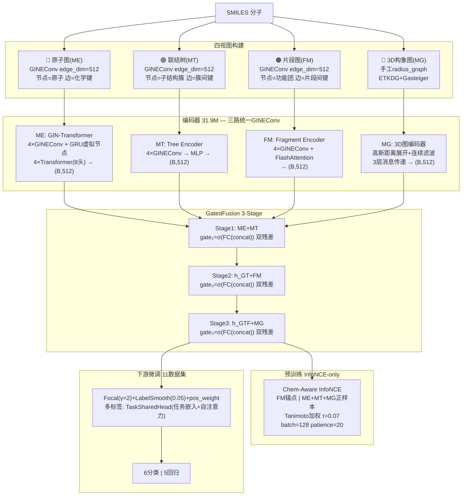

# MMG-MPP 结构框架图

## 整体架构

## 关键设计

| 组件 | 选型 |
|------|------|
| ME/MT/FM图卷积 | **GINEConv (三路统一 edge_dim=512)** |
| MG图卷积 | 手工radius_graph + 高斯滤波 |
| 虚拟节点 | GRUCell (仅ME) |
| FM注意力 | FlashAttention O(N) |
| 融合 | GatedFusion 3-stage (ME+MT→+FM→+MG) |
| 预训练Loss | Chem-Aware InfoNCE-only |
| 分类Loss | Focal(γ=2) / LabelSmooth(0.05) |
| 早停 | 验证驱动 patience=20 |
| 断点 | latest_checkpoint.pt auto-resume |
| 参数 | **31.9M** |
| 预训练数据 | ZINC+ChEMBL Tanimoto精选 ~450K |
| 数据集 | **11** (6分类+5回归) |
